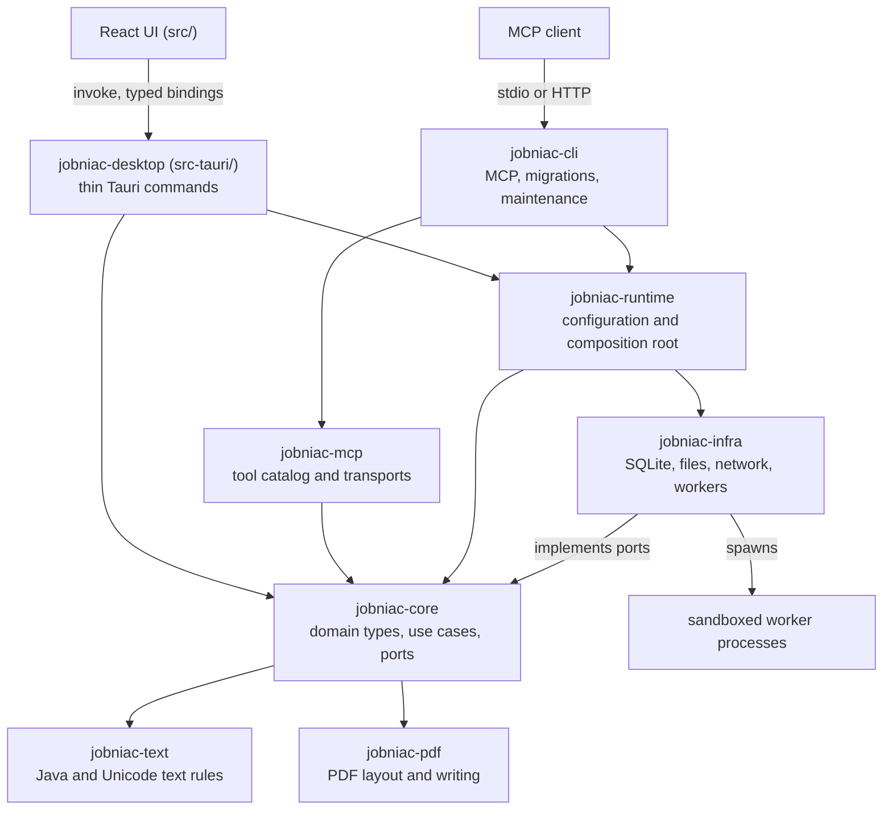

# Architecture

JobniacFast is a Tauri 2 desktop app and an MCP server over one embedded SQLite file. The Rust core holds all business logic. The React UI only renders and holds UI state.

## Layers

Desktop commands and MCP tools sit side by side. Both call the same use cases in `jobniac-core`. Neither calls the other.

## Crates

The Cargo workspace members are under `crates/`. The desktop crate is in `src-tauri/`.

| Crate | Role |
|---|---|
| `jobniac-core` | Framework-free domain types, use cases and ports. No Tauri, database, HTTP or filesystem dependency. |
| `jobniac-infra` | Adapters that implement the core ports: SQLite, filesystem, network fetch, and the worker supervisor. |
| `jobniac-runtime` | Environment configuration and the composition root, used by the desktop app and the CLI. It takes one snapshot of the process environment and wires core use cases to infra adapters. Opt-in features stay off unless their flag is exactly `1`. |
| `jobniac-mcp` | MCP tool catalog, tool framework and transports, built on the `rmcp` SDK. |
| `jobniac-cli` | The `jobniac-cli` console binary: MCP server, migrations, maintenance and the hidden worker modes. |
| `jobniac-pdf` | Deterministic Standard-14 PDF layout and writing, plus structural readback checks. No IO. |
| `jobniac-text` | Java and Unicode text semantics (UTF-16 lengths, whitespace, case, segmentation), pinned by golden vectors. |
| `jobniac-testkit` | Temporary SQLite database helper for tests. |
| `jobniac-desktop` (`src-tauri/`) | The Tauri app. Each `#[tauri::command]` is a thin adapter over a core use case. |

Every command must be registered in `tauri::generate_handler![...]` in `src-tauri/src/lib.rs`. The frontend bindings in `src/ipc/bindings.ts` are generated from the Rust types and CI checks that they are up to date.

## UI

The React 19 and TypeScript UI is in `src/`. It calls Rust through `invoke` from `@tauri-apps/api/core`. Rendering, UI-only state and animation live here. Validation of record, persistence and all IO live in Rust.

`pnpm dev:mock` starts the UI against an in-memory mock IPC (`src/dev`). The browser UI tests run against it.

## IPC rules

- File paths, tokens and secrets never cross IPC.
- `i64` values cross IPC as strings.
- MCP tool names, argument keys, envelopes and error semantics are a stable public contract. See [Contributing Workflow](Contributing-Workflow.md).

## Worker processes

Untrusted input is handled outside the main process. PDF text extraction, PDF page rendering, link fetch and the Arbeitnow board fetch each run in a child process. The child is the hidden mode `jobniac-cli __worker <kind>`.

- The supervisor in `jobniac-infra` starts the child with a fixed environment, enforces a deadline, an output cap and cancellation, and kills the process tree.
- The child applies its own limits and sandbox before it reads its request, and refuses to run unconfined.
- Linux: process groups and resource limits, plus `no_new_privs`, a Landlock ruleset and a seccomp filter. Landlock is used as far as the kernel supports it.
- macOS: process groups, resource limits, a Seatbelt profile per worker kind, and a memory watch by the parent.
- Windows: Job Objects of the parent.

For the source, see `crates/infra/src/workers/` in the [repository](https://github.com/JonHHH09/JobniacFastFs/tree/main/crates/infra/src/workers).

## See also

- [Development Setup](Development-Setup.md)
- [Testing and CI](Testing-and-CI.md)
